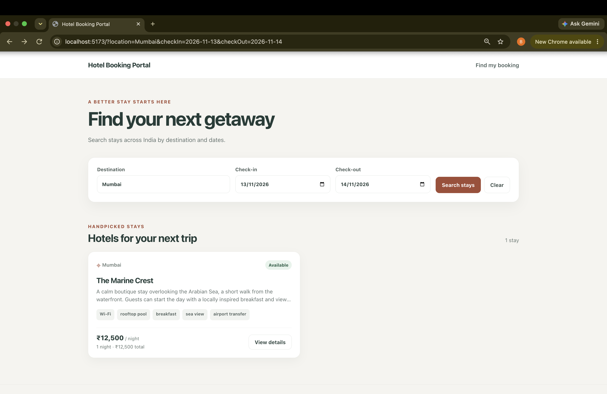
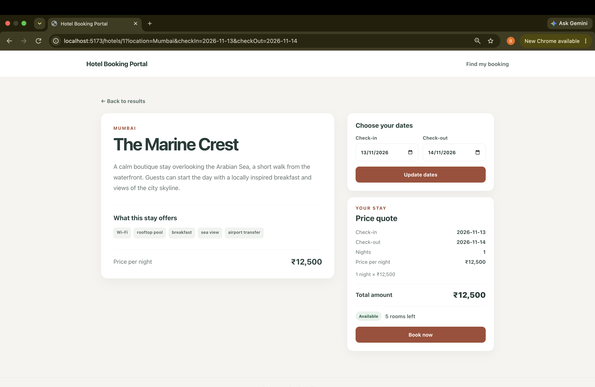
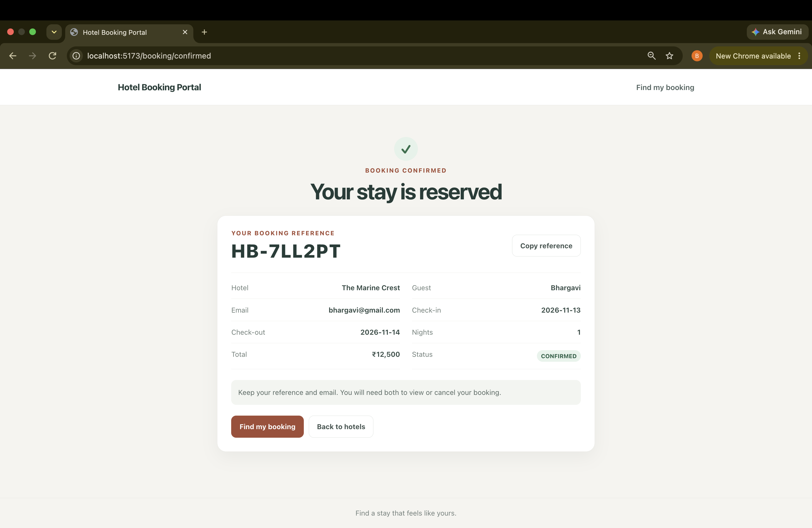
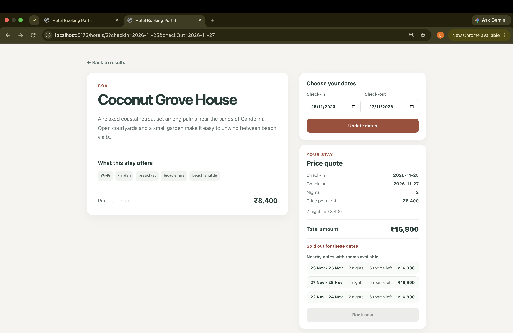
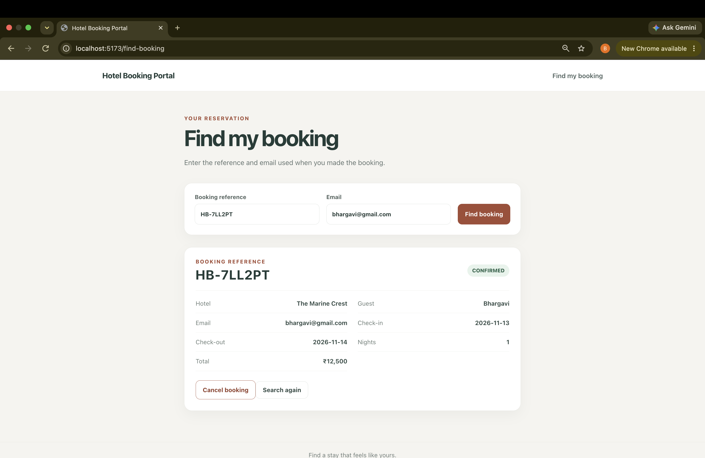

# Hotel Booking Portal

This project is a small hotel search and booking application for Indian hotels.
The React frontend calls a Spring Boot REST API, which stores hotel inventory and bookings in MySQL.
Flyway creates the database schema and sample data when the backend starts.
The backend checks dates, availability and prices, and prevents concurrent bookings from overselling rooms.

## Features

- Browse six seeded hotels and search by location and dates.
- View hotel details, nightly price, availability and a total price quote.
- Book one room, receive a booking reference, and view the confirmation.
- Find and cancel a booking using its reference and the booking email.
- When dates are sold out, see up to three nearby date options for the same number of nights.

## Tech stack

- Java 21, Maven and Spring Boot 3.5.7.
- Spring Data JPA, Bean Validation, Flyway and MySQL Connector/J (versions managed by the Spring Boot 3.5.7 parent in `backend/pom.xml`).
- React `^19.3.1`, React DOM `^19.3.1`, React Router `^7.18.5`, Vite `^8.3.6`, and TypeScript `~7.0.2` (ranges as declared in `frontend/package.json`).
- MySQL 8 or newer.

## Prerequisites

- JDK 21. Check with `java -version`.
- Maven. Check with `mvn -version`.
- Node.js 20.19 or newer and npm. Vite's locked package requires Node 20.19+ (or its listed newer release lines). Check with `node --version` and `npm --version`.
- MySQL 8 or newer. Check the client with `mysql --version` and make sure the MySQL server is running.

## Database setup

Connect to MySQL with an administrator account:

```sh
mysql -u root -p
```

Create the database and a local application user. Replace the sample password with a password you choose, and use the same value for `DB_PASSWORD` in your local `.env` file.

```sql
CREATE DATABASE IF NOT EXISTS hotel_booking
  CHARACTER SET utf8mb4
  COLLATE utf8mb4_unicode_ci;

CREATE USER IF NOT EXISTS 'hotel_app'@'localhost' IDENTIFIED BY 'change_me';
GRANT ALL PRIVILEGES ON hotel_booking.* TO 'hotel_app'@'localhost';
```

On the first backend start, Flyway applies `V1__create_schema.sql` and `V2__seed_data.sql` automatically. The migrations create the tables, insert six sample hotels, and generate 120 days of room inventory from the migration date. Hibernate uses `ddl-auto=validate`; it checks the schema but does not create or update tables.

## Environment variables

Copy `.env.example` to `.env`, then set `DB_URL`, `DB_USER` and `DB_PASSWORD` for your local MySQL instance. `DB_URL` is the JDBC connection URL, `DB_USER` is the database user, and `DB_PASSWORD` is that user's password. The example URL contains `&`; quote the full value in `.env` so the shell reads it as one value:

```sh
cp .env.example .env
```

Edit `.env` so the values are in this form:

```dotenv
DB_URL="jdbc:mysql://localhost:3306/hotel_booking?useSSL=false&serverTimezone=UTC"
DB_USER=hotel_app
DB_PASSWORD=change_me
```

The values above are placeholders; replace `change_me` with the password you chose. Do not commit `.env`.

Load the variables from the repository root in the terminal that will run Maven:

```sh
set -a; source .env; set +a
```

`VITE_API_BASE_URL` is optional. The frontend defaults to `/api`, and the Vite development proxy forwards that path to the backend. Leave the optional setting unset for local development so the proxy is used.

## Running the application

Start MySQL first. In a terminal from the repository root, load `.env` and start the backend:

```sh
set -a; source .env; set +a
cd backend
mvn spring-boot:run
```

The API listens on port 8080. In a second terminal from the repository root, install frontend dependencies and start Vite:

```sh
cd frontend
npm install
npm run dev
```

Open <http://localhost:5173>. Vite proxies `/api` requests to `http://localhost:8080` during development.

## Running the tests

From the repository root, run the backend checks without database variables:

```sh
cd backend
env -u DB_URL -u DB_USER -u DB_PASSWORD mvn clean verify
```

This compiles the backend, runs the service and MVC tests, and packages the application. The MySQL concurrency integration test is skipped when `DB_URL` is not set. It has three test cases and creates and removes its own `ZZ-TEST` hotel and inventory rows. To run those cases against the configured local MySQL database, load all database variables from the repository root, then run Maven:

```sh
set -a; source .env; set +a
cd backend
mvn clean verify
```

Run the frontend TypeScript check and production build with:

```sh
cd frontend
npm run build
```

## API overview

All API paths are under `/api`. Errors use JSON with `timestamp`, `status`, `error`, `message`, `path` and `fieldErrors` fields.

| Method | Path | Purpose | Main error codes |
|---|---|---|---|
| `GET` | `/api/hotels?location=&checkIn=&checkOut=` | List/search hotels; when both dates are supplied, include availability, quote and alternatives. | 400 for invalid dates or unavailable inventory window |
| `GET` | `/api/hotels/{id}?checkIn=&checkOut=` | Get hotel details, optionally with availability and quote. | 400 for invalid dates or unavailable inventory window; 404 if the hotel is unknown |
| `POST` | `/api/bookings` | Create a one-room booking. Returns 201 on success. | 400 for invalid request/dates or unavailable inventory window; 404 for unknown hotel; 409 when a night is sold out |
| `GET` | `/api/bookings/{reference}?email=` | Find a booking by reference and email. | 400 if `email` is missing; 404 for an unknown reference or email mismatch |
| `POST` | `/api/bookings/{reference}/cancel` | Cancel a booking using the email in the JSON body. | 400 for invalid email or a past check-in; 404 for an unknown reference or email mismatch |

Unexpected server errors return 500 with a generic message. Unknown paths return 404 in the same JSON error format.

## Screenshots

The screenshots currently present in `README/docs/` are shown below.



Hotel search results and search controls.



Hotel details with a date-based quote.



Booking confirmation with its reference.



Available alternative dates for a sold-out stay.



Booking lookup and cancellation screen.

## Project structure

```text
backend/                 Spring Boot API, Flyway migrations and tests
frontend/                React + Vite application
README/docs/              Screenshots currently in the repository
README.md                 Local setup and usage instructions
DESIGN.md                 Architecture and implementation decisions
TASKS.md                  Work chunks and progress
.env.example              Environment variable template
```

## Time spent

Approximately 11 hours

## AI tools disclosure

I built this code with heavy use of AI coding tools (Codex), in small reviewed steps tracked in `TASKS.md`. I reviewed and tested the output and can explain it.

## Known limitations and unfinished items

- The inventory covers 120 days from the date the seed migration runs. Dates outside that range cannot be booked.
- Each hotel has one room category, and each booking reserves one room.
- There is no authentication, payment processing or administrative interface.
- The application has no hotel images, pagination or deployment configuration.
- The MySQL concurrency integration tests need a configured local MySQL database and were skipped in the database-free verification run.
- A fresh-clone run-through and the submission email are still manual steps.
